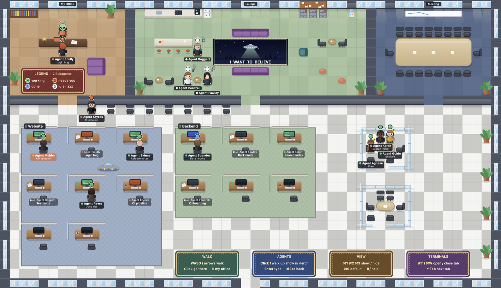

# Agent Office

A walkable 2D office for macOS where every AI coding agent running in [Herdr](https://herdr.dev) –
Claude Code or any other agent Herdr detects – is a character at a desk. Herdr itself runs on the
left, a shell top right, the office bottom right.



Each Herdr space is a team area, each agent sits at its desk with its tab name and a status light.
An agent that needs you walks into your office; the others wait on the chairs outside. Finished
or idle agents take a break in the lounge, subagents are beamed into meeting pods, and agents
announce "done" or "needs you" out loud. Click an agent, or its empty desk, to jump to its tab in
Herdr. The shortcuts are on the rugs by the entrance and in the Help menu (⌘/).

## Requirements

- macOS on Apple Silicon (speech, fonts and the packaged app are Mac-only; Intel is untested)
- Node.js 24 with npm
- [Herdr](https://herdr.dev) with one or more coding agents running in it
- Python 3, only for the Claude Code subagent hooks

## Install and start

```bash
npm install
npm run install-app   # builds the app and copies it to /Applications/Agent Office.app
```

Then start *Agent Office* like any other app. For development, `npm start` runs it from the source.

## Voices

Without extra voices every agent speaks with the macOS default voice. For distinct voices, download
a few English or German ones marked *Premium* or *Enhanced* under System Settings → Accessibility →
Spoken Content → System Voice → Manage Voices, then restart the app.

## Names

Agent Mulder and Agent Scully are always on the team. Replace the other names in
`~/Library/Application Support/agent-office/settings.json` and restart the app:

```json
{ "names": ["Ada", "Linus", "Grace"] }
```

## Subagent hooks

Herdr cannot see subagents. Claude Code can report them through hooks that post to the app; other
agents show up without their subagents.

```bash
npm run hooks:install     # into ~/.claude/settings.local.json (sessions started in ~)
npm run hooks:uninstall
```

For another settings file: `python3 -I scripts/hooks.py install <settings-file>`.

## License

MIT. Unofficial hobby project, not affiliated with or endorsed by Anthropic or Herdr. The agent
names and the UFO decor are a fan nod to a 90s TV series; there is no connection to its makers or
rights holders.
